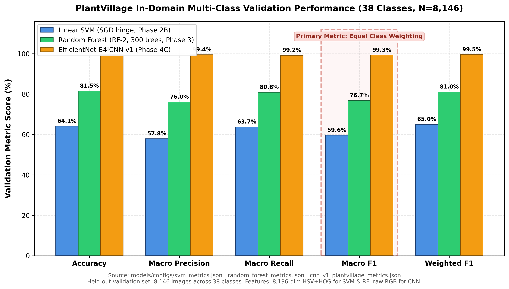
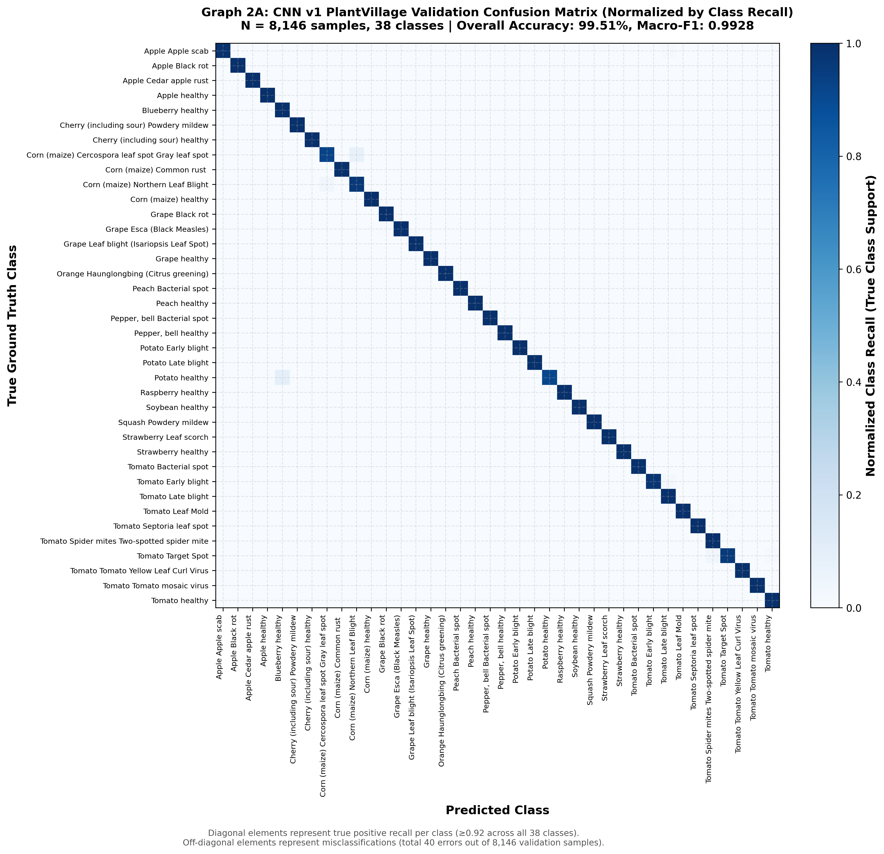
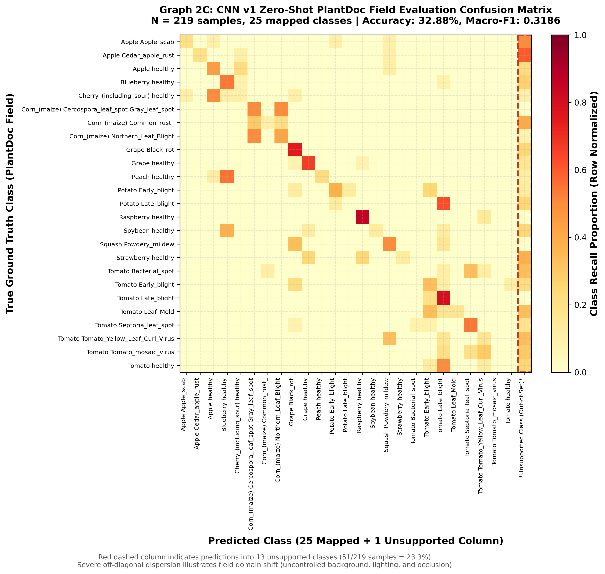
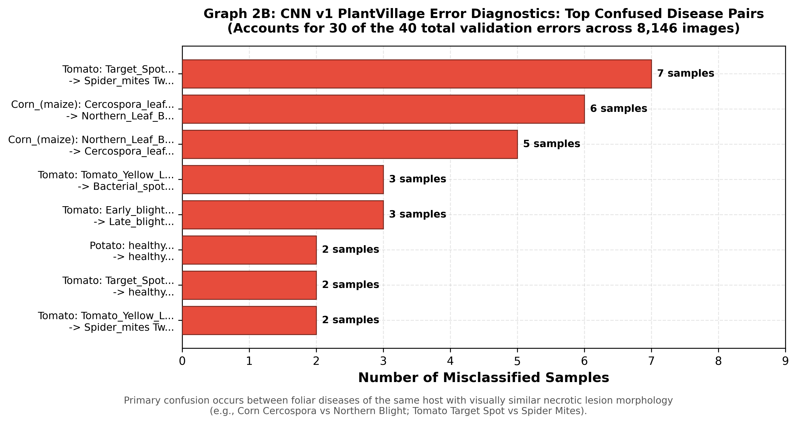
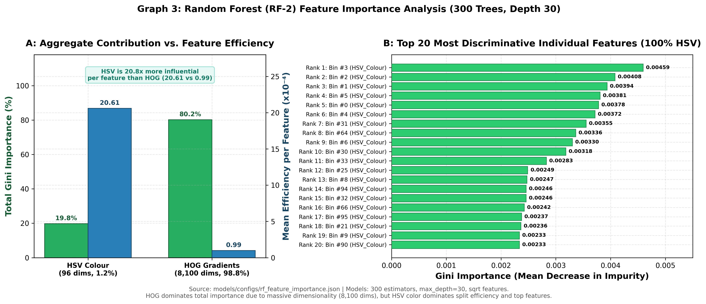
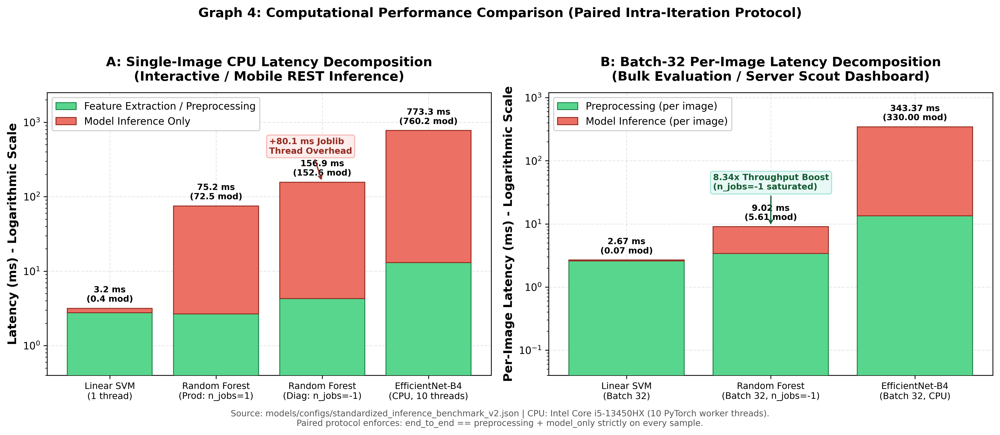
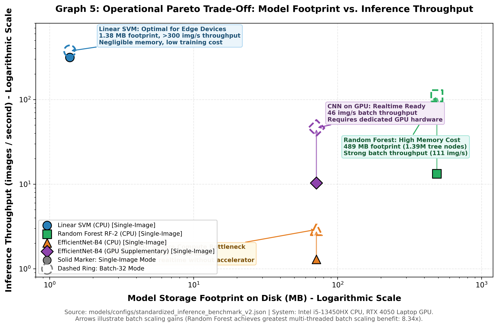
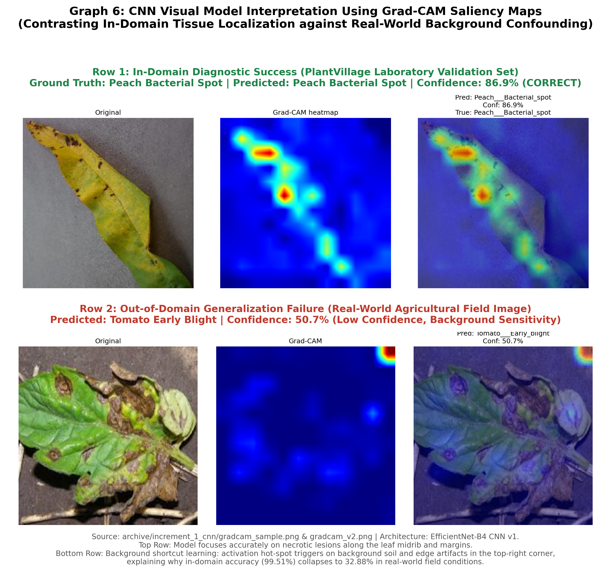

# Crop Disease Identification Using Comparative Machine Learning Approaches

[](LICENSE)
[](https://www.python.org/)
[](https://pytorch.org/)
[](https://scikit-learn.org/)

A rigorous empirical investigation and comparative case study evaluating classical and modern pattern recognition paradigms for automated multi-class agricultural plant pathology across **38 crop-disease categories**.

---

## 1. Project Introduction & Motivation

Agricultural crop diseases reduce global crop yields by 20–40% annually, severely threatening food security and smallholder farmer livelihoods. Timely, accurate disease diagnosis is essential for targeted intervention and mitigating crop loss.

In statistical pattern recognition, crop disease diagnosis poses classic computer vision challenges:
- **High-Dimensional Class Spaces:** Discriminating among 38 visually overlapping foliar conditions across 14 plant species.
- **Complex Morphological Symptoms:** Irregular necrotic lesions, circular spots, chlorotic halos, and powdery fungal efflorescences.
- **Representation vs. Computational Cost:** Balancing high classification fidelity against the operational constraints of battery-powered agricultural IoT devices and mobile field scanners.

This project implements, evaluates, and benchmarks three foundational machine learning paradigms under identical experimental constraints:
1. **Linear Support Vector Machine (Linear SVM)**
2. **Random Forest Ensemble (RF-2)**
3. **Deep Convolutional Neural Network (EfficientNet-B4 CNN v1)**

---

## 2. Implemented Approaches

```
+-------------------------------------------------------------------------------------------------------+
|                                  THREE-APPROACH ARCHITECTURAL TAXONOMY                                |
+---------------------------+-----------------------------------+---------------------------------------+
| Paradigm                  | Model Configuration               | Input Feature Space                   |
+---------------------------+-----------------------------------+---------------------------------------+
| 1. Linear Discriminative  | SGDClassifier (loss="hinge", L2)  | 8,196-dim Handcrafted (HSV + HOG)     |
|    Classifier (Linear SVM)| C = 10.0 (alpha = 1.08e-5)        | Train-only StandardScaler             |
+---------------------------+-----------------------------------+---------------------------------------+
| 2. Non-Linear Decision    | Random Forest (RF-2)              | 8,196-dim Handcrafted (HSV + HOG)     |
|    Tree Ensemble (RF)     | 300 Trees, max_depth=30           | Train-only StandardScaler             |
+---------------------------+-----------------------------------+---------------------------------------+
| 3. Deep Representation    | EfficientNet-B4 CNN v1            | Raw RGB pixels (380x380x3)            |
|    Learning (Deep CNN)    | 19.3M parameters, Pretrained      | End-to-end convolutional features     |
+---------------------------+-----------------------------------+---------------------------------------+
```

### Approach 1: Linear Support Vector Machine
- **Formulation:** Multi-class One-vs-Rest linear hinge-loss classifier trained via stochastic gradient descent (`SGDClassifier`).
- **Mathematical Equivalence:** Regularisation mapped via $\alpha = \frac{1}{N \cdot C}$ ($N=9,299$ training samples, $C=10.0 \implies \alpha = 1.075 \times 10^{-5}$).
- **Feature Pipeline:** 96-dimensional HSV color histograms + 8,100-dimensional Histogram of Oriented Gradients (HOG) ($128\times 128$, $8\times 8$ cells, $2\times 2$ block overlap).
- **Leakage Prevention:** Standardized using a `FeatureScaler` fit strictly on the training subset.

### Approach 2: Random Forest Ensemble (RF-2)
- **Formulation:** Ensemble of 300 orthogonal axis-aligned randomized decision trees with $\text{max\_depth}=30$ and $\text{max\_features}=\sqrt{D}$.
- **Feature Space:** Identical 8,196-dimensional handcrafted HSV + HOG representation.
- **Tree Structure:** Total of 1,393,582 nodes across 300 trees (average 4,645 nodes per tree).

### Approach 3: Deep Convolutional Neural Network (EfficientNet-B4 CNN v1)
- **Formulation:** 19-million parameter deep architecture featuring compound scaling (depth, width, and resolution).
- **Transfer Learning:** Initialized with ImageNet pre-trained representations, featuring a 512-dimensional bottleneck embedding head.
- **Zero-Shot Field Benchmark:** Trained strictly on the 38,013-sample PlantVillage training split with **zero exposure** to PlantDoc field imagery.

---

## 3. Dataset Protocols & Manifests

All evaluations adhere to deterministic, reproducible dataset splits:

1. **PlantVillage (In-Domain Laboratory Benchmark):**
   - **Total Images:** 54,305 leaf images across 38 classes mounted on solid laboratory backgrounds.
   - **Training Partition:** 38,013 images (CNN v1) / 9,299 balanced subset (Classical models).
   - **Validation Partition:** Exactly **8,146 images** evaluated identically across all three models.
   - **Manifest:** [`data/manifests/plantvillage_val.json`](data/manifests/plantvillage_val.json).

2. **PlantDoc (Real-World Out-of-Domain Field Benchmark):**
   - **Total Test Images:** 236 images captured in uncontrolled agricultural fields.
   - **Class Reconciliation:** Exactly **25 classes** (219 images) mapped to PlantVillage; 2 classes (17 images) excluded.
   - **Duplication Audit:** 11 exact train-test duplicate pairs flagged (3 consistent, 8 contradictory labels).
   - **Manifest:** [`data/manifests/plantdoc_test.json`](data/manifests/plantdoc_test.json).

---

## 4. Experimental Results

### PlantVillage Multi-Class Validation Performance ($N = 8,146$, 38 Classes)

| Model Paradigm | Selected Configuration | Accuracy | Macro Precision | Macro Recall | Macro F1 | Weighted F1 | Model Storage |
|---|---|---:|---:|---:|---:|---:|---:|
| **Linear SVM** | SGD hinge, $C=10.0$ | 64.08% | 57.82% | 63.72% | **0.5961** | 0.6496 | **1.38 MB** |
| **Random Forest (RF-2)** | 300 trees, $\text{depth}=30$ | 81.46% | 76.03% | 80.84% | **0.7674** | 0.8102 | 489.28 MB |
| **EfficientNet-B4 CNN v1**| 19M params, Zero-Shot | **99.51%** | **99.42%** | **99.16%** | **0.9928** | **0.9951** | 71.24 MB |

*Exact values extracted from `configs/svm/svm_metrics.json`, `configs/random_forest/random_forest_metrics.json`, and `configs/cnn/cnn_v1_plantvillage_metrics.json`.*

### Why Macro F1 is the Decisive Metric
PlantVillage exhibits a $10.0\times$ class imbalance ratio (from 41 samples in `Apple___Cedar_apple_rust` to 409 samples in `Soybean___healthy`). While Weighted F1 masks underperformance on rare classes by weighting by support, **Macro F1** treats all 38 agricultural pathogens equally. Failing to diagnose an emergent minority pathogen poses severe biosecurity risks.

---

## 5. Graphical Representations

All figures are located in [`figures/`](figures/) in both 300 DPI PNG and vector SVG formats.

### Graph 1: Three-Model Classification Performance Comparison

*Grouped bar chart comparing Accuracy, Macro-P, Macro-R, Macro-F1, and Weighted-F1 across all three approaches on PlantVillage validation ($N=8,146$).*

---

### Graph 2: Confusion Matrices & Error Diagnostics
<p align="center">
  
  
</p>
<p align="center">
  <em>Left: CNN v1 PlantVillage Normalized Confusion Matrix (99.51% accuracy, 40 total errors). Right: CNN v1 Zero-Shot PlantDoc Field Confusion Matrix (32.88% accuracy, 23.3% unsupported predictions).</em>
</p>


*Diagnostic ranking showing the top confused disease pairs responsible for 30 of the 40 total validation errors.*

---

### Graph 3: Random Forest Feature Importance Analysis

*Left: Aggregate Gini importance (HOG 80.22% across 8,100 dimensions vs. HSV 19.78% across 96 dimensions) alongside mean feature importance per dimension (mean HSV importance is ~20.8× higher than mean HOG importance). Right: The top 20 individual features ranked by Gini importance are all HSV colour dimensions. Note: Impurity-based (MDI) importance reflects decision tree split frequency within the handcrafted representation and has documented biases toward continuous features; it measures split utility rather than isolated causal relevance.*

---

### Graph 4: Computational Performance (Paired Latency Decomposition)

*Paired intra-iteration latency decomposition on CPU. Linear SVM executes in 3.17 ms ($243.8\times$ faster than CNN on CPU). Random Forest single-thread ($75.16\text{ ms}$) avoids $+80.11\text{ ms}$ multi-core dispatch penalty.*

---

### Graph 5: Throughput Versus Storage Footprint Trade-off

*Log-Log Pareto frontier mapping Model Storage Footprint against Single-Image and Batch-32 Throughput across deployment niches.*

---

### Graph 6: CNN Visual Model Interpretation Using Grad-CAM

*Top Row: In-Domain diagnostic evaluation on PlantVillage exhibiting localized activation on foliar lesions (86.9% confidence). Bottom Row: Out-of-Domain diagnostic evaluation on PlantDoc field imagery displaying diffuse activation patterns with saliency spanning background soil and non-foliar context (50.7% confidence). While these qualitative visualizations suggest possible sensitivity to background context, Grad-CAM heatmaps do not independently establish shortcut learning or prove the definitive cause of domain generalization failure.*

---

## 6. Computational Performance Benchmark

Measured on Intel Core i5-13450HX CPU (10 worker threads) and NVIDIA RTX 4050 Laptop GPU using the verified paired intra-iteration protocol (`configs/benchmarks/standardized_inference_benchmark_v2.json`):

| Model Paradigm | Execution Mode | Preprocessing Latency | Model-Only Latency | End-to-End Latency | Throughput | Model Storage |
|---|---|---:|---:|---:|---:|---:|
| **Linear SVM** | CPU Single (1 thread) | 2.77 ms | 0.40 ms | **3.17 ms** | **315.26 img/s** | **1.38 MB** |
| | CPU Batch-32 (per img) | 2.60 ms | 0.07 ms | **2.67 ms** | **374.35 img/s** | **1.38 MB** |
| **Random Forest (RF-2)** | CPU Single (Prod: `n_jobs=1`) | 2.67 ms | 72.49 ms | **75.16 ms** | **13.30 img/s** | 489.28 MB |
| | CPU Single (Diag: `n_jobs=-1`)| 4.27 ms | 152.60 ms | **156.87 ms** | 6.37 img/s | 489.28 MB |
| | CPU Batch-32 (`n_jobs=-1`, per img)| 3.41 ms | 5.61 ms | **9.02 ms** | **110.89 img/s** | 489.28 MB |
| **EfficientNet-B4 CNN v1**| CPU Single (10 threads) | 13.08 ms | 760.23 ms | **773.31 ms** | **1.29 img/s** | 71.24 MB |
| | CPU Batch-32 (per img) | 13.37 ms | 330.00 ms | **343.37 ms** | **2.91 img/s** | 71.24 MB |
| **EfficientNet-B4 CNN v1**| GPU Single (Supplementary) | 12.67 ms | 84.37 ms | **97.04 ms** | **10.31 img/s** | 71.24 MB |
| *(Supplementary)* | GPU Batch-32 (per img) | 12.81 ms | 8.84 ms | **21.66 ms** | **46.18 img/s** | 71.24 MB |

---

## 7. Limitations & Threats to Validity

1. **Incomplete Real-World Baseline:** Field evaluation on PlantDoc was conducted strictly for CNN v1 ($32.88\%$ accuracy). Prediction records for Linear SVM and Random Forest on PlantDoc do not exist; speculative scores are not claimed.
2. **CNN v2 Disqualification:** CNN v2 (`best_model_v2.pth`) was exposed to PlantDoc test imagery during incremental fine-tuning and is disqualified from zero-shot field evaluation.
3. **Observed Domain Shift Performance Gap:** CNN v1 validation accuracy of 99.51% on PlantVillage dropped to 32.88% on the unexposed PlantDoc field benchmark, an empirical difference of 66.63 percentage points. While factors such as background complexity, variable illumination, clutter, and contextual feature sensitivity are plausible hypotheses, the exact causal drivers of this generalization failure have not been experimentally isolated.
4. **Hardware Telemetry:** Absolute latencies reflect an Intel 13th Gen mobile processor. While intra-iteration arithmetic holds universally, absolute timings will vary on low-power ARM architectures.

---

## 8. Repository Navigation

```
crop-disease-pattern-recognition/
├── README.md                           # Master project documentation
├── LICENSE                             # MIT Open Source License
├── requirements.txt                    # Exact environment dependencies
├── docs/                               # Comprehensive project documentation
│   ├── project_overview.md             # Academic context and research questions
│   ├── methodology.md                  # Feature extraction and evaluation protocol
│   ├── dataset_documentation.md        # PlantVillage and PlantDoc specifications
│   ├── limitations.md                  # Threats to validity and scope limits
│   ├── repository_packaging_audit.md   # File inventory, exclusions, and integrity checks
│   └── phase_reports/                  # Technical reports for Phases 1 through 4D
├── src/                                # Core algorithmic implementations
│   ├── features/                       # HSV (96) and HOG (8,100) feature extraction
│   ├── svm/                            # SGD hinge-loss Linear SVM
│   ├── random_forest/                  # Random Forest (RF-2) implementation
│   ├── cnn/                            # EfficientNet-B4 inference adapter
│   └── evaluation/                     # Paired inference benchmarking harness
├── configs/                            # Authoritative experimental configs and metrics
├── data/                               # Dataset access guide and manifests
│   ├── README.md                       # Download and partition instructions
│   └── manifests/                      # Validation and test manifests
├── results/                            # Machine-readable evaluation records
├── figures/                            # All 6 graphical representation categories (PNG & SVG)
├── models/                             # Checkpoint registry, hashes, and download guide
├── tests/                              # Verification test suite
└── scripts/                            # Standalone figure generation and verification runners
```

---

## 9. Installation & Usage

### 9.1 Environment Setup
```bash
# Clone the repository
git clone https://github.com/arya20072004/crop-disease-pattern-recognition.git
cd crop-disease-pattern-recognition

# Create virtual environment
python -m venv .venv
source .venv/bin/activate  # On Windows: .venv\Scripts\activate

# Install dependencies
pip install -r requirements.txt
```

### 9.2 Running Verification Tests
```bash
# Execute repository verification test suite
pytest tests/ -v
```

### 9.3 Re-Generating Graphical Figures
```bash
# Generate all 6 graphical categories into figures/
python scripts/generate_all_figures.py
```

---

## 10. Group Acknowledgements

This case study was prepared for the Pattern Recognition CCA 1 Case Study evaluation by:

- **Arya Sandeep Borhade**
- **Suyash Sunam**
- **Abhir Bengali**

**Project Contributions:**
- Classical Feature Engineering & Linear SVM Implementation
- Random Forest Optimization & Feature Importance Analysis
- Deep CNN Benchmarking & PlantDoc Generalization Audit
- Computational Latency Harness & Empirical Comparative Synthesis

*Course Evaluation: Pattern Recognition CCA 1 Case Study (Academic Year 2025–2026).*
