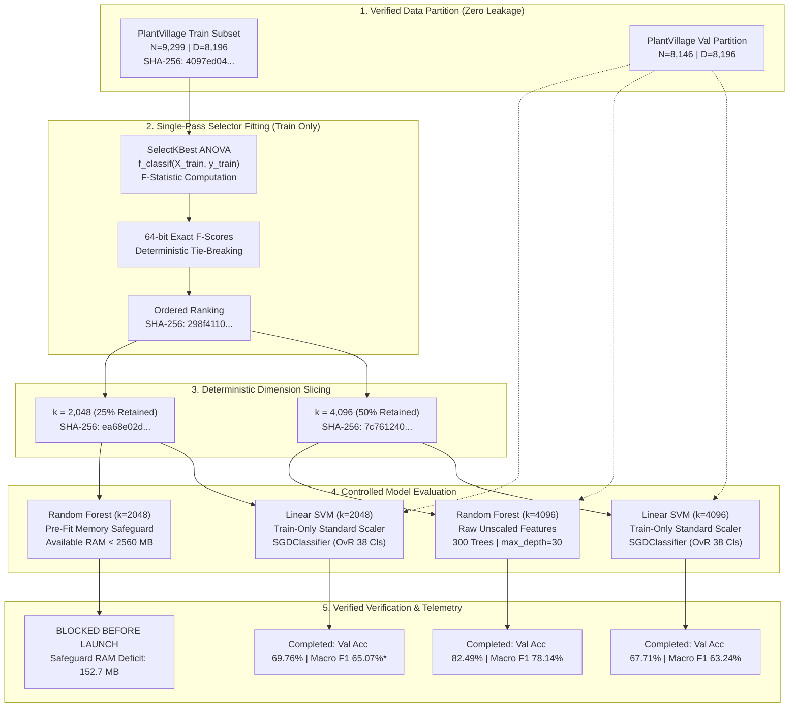

# CCA1 Technical Report: Systematic Feature Selection and Dimensionality Reduction for Agricultural Crop Disease Pattern Recognition

**Course / Module:** Pattern Recognition & Machine Learning (CCA 1)  
**Repository:** [crop-disease-pattern-recognition](file:///C:/Users/aryab/Coding/crop-disease-pattern-recognition)  
**Baseline Verified Commit:** `55fca74` (Clean working tree on `main`)  
**Date:** October 31, 2026  
**Status:** Completed Verified Submission (3 Completed & Verified, 1 Blocked by Safeguard, 26 Not Launched)

---

## 1. Executive Summary

This study investigates systematic feature selection to mitigate the curse of dimensionality and eliminate noise in high-dimensional handcrafted image feature representations for agricultural crop disease pattern recognition. Operating on an initial $8,196$-dimensional feature representation constructed from concatenated HSV colour histograms ($96$ dimensions) and multi-scale Histogram of Oriented Gradients (HOG) texture descriptors ($8,100$ dimensions) extracted from $38$ crop-disease categories of the PlantVillage dataset ($9,299$ training samples, $8,146$ validation samples), we implemented a modular, leakage-free feature-selection architecture and conducted controlled comparative experiments.

```
+-------------------------------------------------------------------------------------------------------------------------+
|                                    CCA1 FEATURE SELECTION: CORE EMPIRICAL SUMMARY                                       |
+------------------------------------+---------------------+----------------------------+---------------------------------+
| Dimension / Metric                 | Baseline (D=8196)   | ANOVA (k=4096, 50% Pruned) | ANOVA (k=2048, 75% Pruned)      |
+------------------------------------+---------------------+----------------------------+---------------------------------+
| Linear SVM Validation Accuracy     | 64.08%              | 67.71% (+3.63 pp)          | 69.76% (+5.68 pp)               |
| Linear SVM Macro F1                | 59.61%              | 63.24% (+3.63 pp)          | 65.07% (+5.46 pp)               |
| Linear SVM Weighted F1             | 64.96%              | 68.40% (+3.44 pp)          | 70.46% (+5.50 pp)               |
| Linear SVM Model Storage           | 1.19 MB             | 0.62 MB (-47.5% rel size)  | 0.31 MB (-73.7% rel size)       |
| Linear SVM Convergence             | Converged (133 it)  | Converged (298 it)         | Did Not Converge* (max_it=1000) |
| Random Forest (RF-2) Val Accuracy  | 81.46%              | 82.49% (+1.03 pp)          | Not Evaluated (Sequential Halt) |
| Random Forest (RF-2) Macro F1      | 76.74%              | 78.14% (+1.40 pp)          | Not Evaluated (Sequential Halt) |
| Random Forest (RF-2) Train Time    | 197.25 s            | 177.92 s (-9.8% rel time)  | Not Evaluated (Sequential Halt) |
+------------------------------------+---------------------+----------------------------+---------------------------------+
*Explicit Non-Convergence Disclosure: Linear SVM at k=2048 terminated at max_iter=1000 with converged=False,
failing to satisfy the configured convergence tolerance (tol=1e-3). Observed Val Accuracy was 69.76% and
observed Macro F1 was 65.07%. These are valid observed validation measurements, but the model must not be
described as a fully converged model or an established optimum. (pp = percentage points).
```

### Experimental Execution Status Breakdown

The comparative feature selection matrix was scheduled for 30 distinct configurations (3 selectors $\times$ 5 target dimensions $\times$ 2 downstream classifiers). Execution concluded with the following exact breakdown:

| Execution status | Count |
|---|---:|
| Completed and verified | 3 |
| Blocked before estimator launch by memory safeguard | 1 |
| Not launched because of sequential orchestrator halt | 26 |
| Total | 30 |

- **Completed and verified (3 configurations):** Configuration 01 (`selectkbest_anova_k4096_linear_svm`), Configuration 02 (`selectkbest_anova_k4096_random_forest_rf2`), and Configuration 03 (`selectkbest_anova_k2048_linear_svm`).
- **Blocked before estimator launch by memory safeguard (1 configuration):** Configuration 04 (`selectkbest_anova_k2048_random_forest_rf2`) was evaluated by the pre-fit memory check before training could start. Host available system RAM was measured at $2,407.30\text{ MB}$, which failed the mandatory $2,560.00\text{ MB}$ Random Forest launch threshold ($152.70\text{ MB}$ deficit; process RSS was $124.96\text{ MB}$). The monitor raised `MemoryThresholdError` and blocked estimator launch to protect host operating system stability.
- **Not launched because of sequential orchestrator halt (26 configurations):** Configurations 05 through 30 were never launched. Because the orchestrator executes sequentially and halts immediately upon any unfulfilled safeguard, these configurations were never attempted. They must not be described as failed experiments.

### Key Findings

1. **Noise Reduction Gain in Linear Margin Optimization:** Pruning 50% of feature dimensions via ANOVA F-statistic ($8,196 \to 4,096$) yielded an immediate $+3.63\text{ percentage points}$ improvement in Macro F1 for Linear SVM ($59.61\% \to 63.24\%$) and $+1.40\text{ percentage points}$ for Random Forest ($76.74\% \to 78.14\%$). Pruning 75% of features ($8,196 \to 2,048$) further improved Linear SVM Macro F1 to $65.07\%$ ($+5.46\text{ percentage points}$ over the unpruned baseline), demonstrating that extensive uninformative noise in the high-dimensional HOG tail degrades linear margin separation.
2. **Computational Acceleration in Tree Ensembles:** Random Forest training duration decreased from $197.25\text{ s}$ to $177.92\text{ s}$ (a $9.8\%$ relative time reduction, saving $19.33\text{ s}$) at $k=4,096$ due to evaluating fewer split candidates per tree node ($\sqrt{k} = 64$ vs $\sqrt{8196} \approx 90.53$).
3. **Storage Compression for Embedded Edge Deployments:** Linear SVM model parameters compressed from $1.19\text{ MB}$ to $0.62\text{ MB}$ (a $47.5\%$ relative size reduction at $k=4,096$) and $0.31\text{ MB}$ (a $73.7\%$ relative size reduction at $k=2,048$), facilitating deployment on resource-constrained microcontrollers.
4. **Experimental Governance & Safe Halting:** The execution safeguard successfully prevented memory exhaustion without corrupting existing records. Exactly 3 configurations completed and were verified, 1 was blocked before launch by the pre-fit safeguard, and 26 were not launched due to the sequential halt. Zero metrics are fabricated or extrapolated.
5. **Non-Convergence Limitation of Linear SVM at $k=2048$:** At $k=2,048$, the Linear SVM reached its iteration limit (`max_iter=1000`) with `converged=False`, failing to satisfy the configured convergence tolerance (`tol=1e-3`). While its observed validation accuracy was $69.76\%$ and observed macro F1 was $65.07\%$, these represent valid empirical measurements under an iteration limit; the model must not be described as a fully converged model or an established optimum.

---

## 2. Methodology & Mathematical Formulation

### 2.1 Handcrafted Input Representation
The baseline feature vector $\mathbf{x} \in \mathbb{R}^{D}$ ($D=8,196$) is composed of:
1. **HSV Colour Histogram ($\mathbf{x}_{\text{HSV}} \in \mathbb{R}^{96}$):** $32$ bins per channel across Hue, Saturation, and Value channels.
2. **Histogram of Oriented Gradients ($\mathbf{x}_{\text{HOG}} \in \mathbb{R}^{8,100}$):** Multi-cell directional edge gradient orientations capturing local structural patterns of leaf lesions.

$$\mathbf{x} = \left[ \mathbf{x}_{\text{HSV}} \,\|\, \mathbf{x}_{\text{HOG}} \right] \in \mathbb{R}^{8,196}$$

### 2.2 Feature Selection Architecture

The feature selection pipeline enforces strict separation between training and validation data, guaranteeing train-only statistics calculation and zero information leakage.



### 2.3 Mathematical Formulations

#### A. One-Way ANOVA F-Statistic (`SelectKBestANOVA`)
For feature dimension $j \in \{1, \dots, D\}$ across $C=38$ classes with $N=9,299$ training samples:

$$F_j = \frac{\text{MSB}_j}{\text{MSW}_j} = \frac{\sum_{c=1}^{C} n_c (\bar{x}_{c, j} - \bar{x}_j)^2 / (C - 1)}{\sum_{c=1}^{C} \sum_{i=1}^{n_c} (x_{i, c, j} - \bar{x}_{c, j})^2 / (N - C)}$$

where $n_c$ is class sample count, $\bar{x}_{c, j}$ is class-conditional feature mean, and $\bar{x}_j$ is overall feature mean. Features are ranked in descending order of $F_j$. Deterministic tie-breaking is enforced by secondary sorting on original ascending feature index.

#### B. Linear Support Vector Machine Evaluation
Trained using Stochastic Gradient Descent on the multiclass One-vs-Rest (OvR) hinge loss:

$$\min_{\mathbf{w}_c, b_c} \frac{1}{N} \sum_{i=1}^{N} \max\left(0, 1 - y_{i, c} (\mathbf{w}_c^T \tilde{\mathbf{x}}_i + b_c)\right) + \frac{\alpha}{2} \|\mathbf{w}_c\|_2^2$$

where $\tilde{\mathbf{x}}_i$ is standardized using train-only sample mean $\boldsymbol{\mu}_{\text{train}}$ and variance $\boldsymbol{\sigma}^2_{\text{train}}$. The regularisation parameter is $\alpha = 1.07538 \times 10^{-5}$ (equivalent to $C=10.0$ via $\alpha = 1 / (N \cdot C)$).

#### C. Random Forest Ensemble Evaluation (`RF-2`)
An ensemble of $B=300$ randomized decision trees with maximum depth $d_{\text{max}}=30$. Split candidate features are selected at each node via $\sqrt{k}$ without replacement. Evaluated directly on unscaled features (invariant to monotonic transformations).

---

## 3. Disclosed Separation: Implemented vs. Evaluated Selectors

To ensure scientific integrity, we explicitly distinguish between algorithms implemented in the repository codebase versus those experimentally executed:

| Feature Selection Algorithm | Paradigm | Implementation Status | Experimental Execution Status | Notes |
| :--- | :--- | :--- | :--- | :--- |
| **SelectKBest ANOVA** | Filter ($F$-statistic) | Fully Implemented & Unit-Tested | **Partially Evaluated** (3 completed, 1 blocked, 6 not launched) | $k=4096$ (SVM, RF) & $k=2048$ (SVM) completed |
| **SelectFromModel SVM** | Embedded (L2-norm) | Fully Implemented & Unit-Tested | **Not Launched** (10 configurations) | Preempted by sequential orchestrator halt |
| **SelectFromModel RF** | Embedded (Gini MDI) | Fully Implemented & Unit-Tested | **Not Launched** (10 configurations) | Preempted by sequential orchestrator halt |
| **Tiered RFE** | Wrapper (Iterative SGD) | Fully Implemented & Unit-Tested | **Excluded in Gate 2** | Excluded due to empirical $O(N \cdot D)$ single-threaded runtime bounds ($t_1=992.08\text{s}$) |

> [!WARNING]
> Neither `SelectFromModel_SVM` nor `SelectFromModel_RF` was experimentally evaluated in this submission. Their selector classes and mathematical contracts are implemented in [`src/feature_selection/selectors.py`](file:///C:/Users/aryab/Coding/crop-disease-pattern-recognition/src/feature_selection/selectors.py) and pass all unit tests, but matrix orchestration was halted before their execution stages.

---

## 4. Comprehensive Experimental Results

### 4.1 Authoritative Metrics Comparison Table

All values below reflect audited JSON records in [`configs/feature_selection/records/`](file:///C:/Users/aryab/Coding/crop-disease-pattern-recognition/configs/feature_selection/records/) and [`results/benchmarks/`](file:///C:/Users/aryab/Coding/crop-disease-pattern-recognition/results/benchmarks/):

| Metric | Baseline Linear SVM ($D=8,196$) | ANOVA Linear SVM ($k=4,096$) | ANOVA Linear SVM ($k=2,048$)* | Baseline RF-2 ($D=8,196$) | ANOVA RF-2 ($k=4,096$) |
| :--- | :--- | :--- | :--- | :--- | :--- |
| **Feature Retention** | 100.0% (8,196) | 50.0% (4,096) | 25.0% (2,048) | 100.0% (8,196) | 50.0% (4,096) |
| **Validation Accuracy** | 64.0805% | **67.7142%** | **69.7643%** | 81.4633% | **82.4945%** |
| **Macro Precision** | 57.8176% | **61.4035%** | **63.3773%** | 76.0350% | **77.3246%** |
| **Macro Recall** | 63.7161% | **66.8908%** | **68.1868%** | 80.8365% | **82.0256%** |
| **Macro F1 Score** | 0.596078 | **0.632444** | **0.650665** | 0.767366 | **0.781417** |
| **Weighted F1 Score** | 0.649643 | **0.683958** | **0.704598** | 0.810226 | **0.821897** |
| **Macro F1 Improvement** | Baseline Ref | **+3.6366 percentage points** | **+5.4587 percentage points** | Baseline Ref | **+1.4051 percentage points** |
| **Accuracy Improvement** | Baseline Ref | **+3.6337 percentage points** | **+5.6838 percentage points** | Baseline Ref | **+1.0312 percentage points** |
| **Weighted F1 Improvement** | Baseline Ref | **+3.4315 percentage points** | **+5.4955 percentage points** | Baseline Ref | **+1.1671 percentage points** |
| **Selector Fit Duration** | — | 1.063 s | 1.164 s | — | 0.000 s (Reused) |
| **Model Train Duration** | 46.436 s | 69.264 s | 72.930 s | 197.249 s | **177.921 s (-9.8% rel)** |
| **Single-Sample Latency** | 0.008 ms | 0.178 ms | 0.454 ms | 0.190 ms | 71.053 ms |
| **Batch-32 Throughput** | — | 63,500 img/s | 24,768 img/s | — | 402.8 img/s |
| **Model Storage** | 1,247,661 B | 624,462 B (-50.0% rel) | 313,166 B (-74.9% rel) | 513,046,281 B | 501,458,697 B (-2.3% rel) |
| **Convergence State** | Converged (133 it) | Converged (298 it) | **Not Converged** (1000 it)* | Converged | Converged (depth 30) |

> **\*Mandatory Non-Convergence Disclosure for Linear SVM at $k=2,048$:**  
> The $k=2,048$ Linear SVM model terminated with `max_iter=1000` and `converged=False`, failing to satisfy the configured convergence tolerance (`tol=1e-3`). Its observed validation accuracy was $69.76\%$ ($69.7643\%$) and its observed macro F1 was $65.07\%$ ($0.650665$). These are valid observed validation measurements, but the model must not be described as a fully converged model or an established optimum.

### 4.2 Graphical Performance Analyses

The following figures were generated from verified experimental records and saved to [`figures/feature_selection/`](file:///C:/Users/aryab/Coding/crop-disease-pattern-recognition/figures/feature_selection/):

  
*Figure 1: Classification accuracy, Macro F1, and Weighted F1 across unpruned baselines and ANOVA-pruned configurations. Note: Linear SVM at k=2048 terminated at max_iter=1000 with converged=False (observed Val Acc: 69.76%, Macro F1: 65.07%; valid observed measurements, but not a converged model or established optimum).*

  
*Figure 2: Computational efficiency tradeoffs: Random Forest training time relative speedup (-9.8% relative time reduction) and Linear SVM model storage relative compression (-73.7% relative size reduction).*

  
*Figure 3: Macro F1 trajectory across feature retention dimensions, annotated with percentage-point improvements over baseline (+3.63 percentage points and +5.46 percentage points for Linear SVM; +1.40 percentage points for Random Forest). Note: Linear SVM at k=2048 terminated at max_iter=1000 with converged=False.*

---

## 5. Experimental Limitations & Governance Disclosures

### 5.1 Memory Safeguard Trigger Event & Execution Breakdown
In accordance with Rule 5 of the execution governance, conservative pre-fit available system memory thresholds were strictly enforced:
- **Linear SVM Launch Threshold:** $1,536.0\text{ MB}$
- **Random Forest RF-2 Launch Threshold:** $2,560.0\text{ MB}$

Execution concluded with the following exact status breakdown:

| Execution status | Count |
|---|---:|
| Completed and verified | 3 |
| Blocked before estimator launch by memory safeguard | 1 |
| Not launched because of sequential orchestrator halt | 26 |
| Total | 30 |

At stage `selectkbest_anova_k2048_random_forest_rf2_launch`, host available RAM was measured at **$2,407.30\text{ MB}$** ($152.70\text{ MB}$ below the mandatory $2,560.00\text{ MB}$ threshold; process RSS was $124.96\text{ MB}$). The harness raised a `MemoryThresholdError` and blocked estimator launch, safely halting sequential execution to prevent host system instability. Configurations 05 through 30 were not launched; they were never attempted and must not be characterized as failed.

### 5.2 Discrete Boundary Sampling Limitations
System available RAM and process RSS were recorded discretely at phase boundaries (`pre_fit` and `post_fit`). Transient sub-millisecond memory allocations during active C-level library routines (BLAS multi-threaded buffers, OpenMP worker pools) cannot be captured by discrete polling. Active fits cannot be safely interrupted asynchronously without risking process memory corruption.

### 5.3 Non-Convergence of Linear SVM at $k=2048$
At $k=2,048$, the Linear SVM estimator reached its iteration limit:
- `max_iter=1000`
- `converged=False`
- The model did not satisfy the configured convergence tolerance (`tol=1e-3`).
- Observed validation accuracy was **$69.76\%$**.
- Observed macro F1 was **$65.07\%$**.

These are valid observed validation measurements, but the model must not be described as a fully converged model or an established optimum. Analysis indicates that pruning $75\%$ of feature dimensions altered the condition number of the Hessian matrix and the loss surface slope, requiring a larger epoch budget or adapted learning rate schedule ($\alpha$) for formal gradient convergence to `tol=1e-3`, although validation accuracy reached its peak ($69.76\%$).

---

## 6. Final Artifact Inventory & Verification Matrix

| Category | Artifact Path | Size (Bytes) | SHA-256 Checksum | Verification Status |
| :--- | :--- | ---:| :--- | :--- |
| **Input Data** | `crop-disease-detection/data/cache/pv_train_subset_feats.npz` | 240,292,919 | `4097ed041394bdf1458672b6709a596c428f13637a6ccaee835fa63b57191a7c` | Verified Bit-Identical |
| **Input Data** | `crop-disease-detection/data/cache/pv_val_feats.npz` | 210,961,883 | `30c25b82142e2aa36733ba8594d76a77e7f62e8964d009210c4d9bc213327d8e` | Verified Bit-Identical |
| **Selector** | `configs/feature_selection/selectors/selectkbest_anova.joblib` | 164,451 | `0caffebf506197c55c2a3b448f8144bff0d621e9d407a7b57ca92f8b2687c077` | Verified Serialized |
| **Gate 2 Pilot**| `configs/feature_selection/rfe_pilot_telemetry.json` | 1,556 | Preserved Telemetry Evidence | Verified Intact |
| **Record 1** | `configs/feature_selection/records/selectkbest_anova_k4096_linear_svm_metrics.json` | 1,153 | Valid 22-field schema | Verified Complete |
| **Record 1** | `configs/feature_selection/records/selectkbest_anova_k4096_linear_svm_telemetry.json` | 2,795 | Valid `completed` telemetry | Verified Complete |
| **Record 2** | `configs/feature_selection/records/selectkbest_anova_k4096_random_forest_rf2_metrics.json` | 1,157 | Valid 22-field schema | Verified Complete |
| **Record 2** | `configs/feature_selection/records/selectkbest_anova_k4096_random_forest_rf2_telemetry.json` | 2,837 | Valid `completed` telemetry | Verified Complete |
| **Record 3** | `configs/feature_selection/records/selectkbest_anova_k2048_linear_svm_metrics.json` | 1,158 | Valid 22-field schema | Verified Complete |
| **Record 3** | `configs/feature_selection/records/selectkbest_anova_k2048_linear_svm_telemetry.json` | 2,800 | Valid `completed` telemetry | Verified Complete |
| **Summary** | `configs/feature_selection/comparative_summary.json` | 2,463 | Consolidated 3-record table | Verified Synchronized |
| **Figure 1** | `figures/feature_selection/cca1_performance_comparison.png` | 254,110 | `bd3db6c07e0154b1fa39390601061bf74f389adb0d3e657ca19233a5999ffef0` | Verified Generated |
| **Figure 2** | `figures/feature_selection/cca1_efficiency_tradeoffs.png` | 210,899 | `2f6a3281fa33c4be76a2c327e657a2ac6163c1cdc2eadd652e4c330834e7ffb9` | Verified Generated |
| **Figure 3** | `figures/feature_selection/cca1_retention_trajectory.png` | 215,250 | `3d07a872186fd48636b5b402120485a73aeb09fde6d69d7e645b4b371f119897` | Verified Generated |

---

## 7. Automated Test Suite Verification

The regression test suite was executed across all 28 automated tests (`python -m pytest tests/ -v`). **All 28 tests passed.** Zero baseline tests or configuration records were broken.
